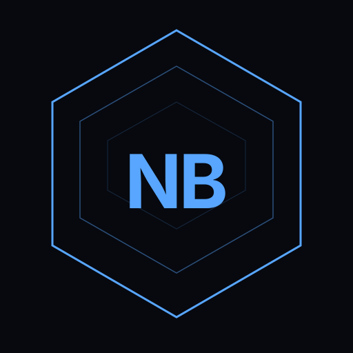

<div align="center">

<div></div>

<div></div>

# NovaByte Studio

**A desktop IDE for building and packaging `.novaapp` applications for NovaByte OS and compatible NBOSP systems.**

<br>

[](https://github.com/DirazCoder/novapack-studio)
[](https://nodejs.org)
[](#)
[](https://github.com/DirazCoder/novapack-studio/releases)
[](./LICENSE)

<br>

[**Getting Started**](#getting-started) · [**Templates**](#available-templates) · [**Build from source**](#build-from-source) · [**.novaapp Guide**](./NOVAAPP.md)

</div>

---

> ### ⚠️ Read this before you build anything
>
> These app-development rules prevent common first-build and install failures:
>
> 1. **Reference your script, never inline it.** In `index.html`, use `<script src="app.js" defer></script>` — a local relative path to a sibling file. An inline `<script>...code...</script>` block with actual code inside it is flagged by the install-time content scanner and **blocks install outright, no exceptions.** See the [Content Scanner guidance in the `.novaapp` guide](./NOVAAPP.md#content-scanner--avoiding-false-positives-on-install).
> 2. **No DOM-ready wrapper is needed for packaged scripts.** The NovaByte host defers external scripts in the packaged entry HTML until parsing completes, so ordinary DOM lookups in `app.js` can find elements declared in the page. Dynamically created scripts or documents retain normal browser timing.

---

## What is NovaByte Studio

NovaByte Studio is a desktop IDE (built on NW.js) for creating, building, and packaging `.novaapp` applications. It gives you a GUI to scaffold new projects from templates, edit your code with a full-featured CodeMirror 6 editor, manage your manifest and permissions, build your package, and inspect the output — all without touching a CLI.

Studio creates `.novaapp` packages for NovaByte OS and compatible NBOSP systems. See the [separate `.novaapp` guide](./NOVAAPP.md) for the manifest, runtime APIs, permissions, and package format.

---

## Download

NovaByte Studio is available for Windows, macOS, and Linux. Download the latest release for your platform from the [Releases](https://github.com/DirazCoder/novapack-studio/releases) page, extract the archive, and run the executable — no install required.

### Build from source

Run `npm install` once, then use `npm run build` to build all platforms. To build only selected platforms, pass one or more flags:

```sh
npm run build -- --win
npm run build -- --mac
npm run build -- --linux
npm run build -- --win --linux
```

The flags also accept `--windows` and `--macos` aliases. A platform-specific build replaces only that platform's output under `dist/`; other platform builds are left untouched. Run `npm run build -- --help` to see usage.

---

## Getting Started

### Prerequisites

- Basic HTML, CSS, and JavaScript knowledge
- For the `native-cpp` template only: packaged Studio releases include a platform-specific Emscripten SDK. When running Studio from source or a development build, install [Emscripten](https://emscripten.org/docs/getting_started/downloads.html) (`emcc`) and make it available on your PATH.

### Supported languages

| Language | How it runs | Notes |
|----------|-------------|-------|
| JavaScript | Native — runs as-is in the webview | No build step required |
| HTML | Native — runs as-is in the webview | No build step required |
| CSS | Native — runs as-is in the webview | No build step required |
| TypeScript | Editor-only (intellisense/type-checking) | Not compiled or transpiled by Build — write plain JS for anything that ships |
| C/C++ | Compiled to WebAssembly via `emcc` at Build time | Packaged releases include Emscripten; source/development builds need an SDK on PATH |

### Available templates

| Template | Description |
|----------|-------------|
| `blank` | Empty shell — start from scratch |
| `webapp` | Pins one external site as its own app — fixed URL, no address bar or navigation |
| `browser` | URL bar with back, forward, and reload — requests `sandbox:nested-webview` and `net:external` access |
| `utility` | File-access tool using NovaByte's virtual filesystem |
| `game` | Game loop skeleton with canvas rendering |
| `dashboard` | Data widget grid with live update pattern |
| `form` | Structured form that saves entries via NovaByte's virtual filesystem |
| `markdown-viewer` | Live markdown preview using a bundled vendor library |
| `chat` | Message list with input — client-side state, no permissions needed |
| `native-cpp` | C++ compiled to WebAssembly, UI in HTML/CSS/JS — packaged releases include Emscripten |
| `notifications-api` | Create channels, post notifications, and read notification actions |
| `alarms-api` | Schedule named alarms and subscribe to alarm events |
| `clipboard-api` | Copy text and request permission before reading the clipboard |
| `dialogs-api` | Open user-mediated file and save pickers |
| `app-integration-api` | Inspect, list, and launch apps or open the share sheet |
| `settings-window-api` | Read or update allowlisted settings and inspect window state |
| `device-apis` | Request geolocation, camera, or microphone access on demand |
| `calendar-contacts-api` | Read or add sample records in shared calendar and contacts |
| `data-backup-api` | Create and restore checksummed, app-scoped data backups |
| `events-lifecycle-api` | Subscribe and unsubscribe from system events |
| `secrets-api` | Store credentials in the encrypted app-scoped secrets store |
| `share-target-api` | Receive content explicitly shared to the app by the user |

NovaApp API starters use the v2 `window.novaOS` facade. Sensitive integrations are declared as optional permissions and requested only when the user chooses the corresponding action; each declared grant includes a `permissionReasons` entry.

Template artwork is embedded as SVG data in both the project picker and the generated app's `manifest.json`; no external icon files or network fetches are needed.

### Bundled external dependencies (`vendor/`)

Every new project includes a `vendor/` directory. Drop single-file libraries there (JS or CSS) and they are bundled automatically when you Build — no CDN required.

```
vendor/
  markdown-it.min.js
  chart.min.js
```

Reference them in your HTML as:

```html
<script src="vendor/markdown-it.min.js" defer></script>
```

Only copy the final built/minified file you need — don't copy entire `node_modules` folders.

### Excluding files from the build (`.studioignore`)

Add a `.studioignore` file to your project root to exclude files/folders from packaging without deleting them from disk — build logs, local test fixtures, secrets you don't want bundled, anything you're keeping around locally but don't want shipped in the `.novaapp`.

Syntax is `.gitignore`-style (globs, `!` negation, `#` comments):

```
# ignore build logs entirely
logs/

# ignore any .env file anywhere in the project
*.env

# but keep this one specific env file
!config/required.env
```

`.studioignore` itself is never packaged — dotfiles are already excluded from every build regardless.

**No exemptions, same as `.gitignore`:** there's no protected list of "important" files. If a pattern matches your `manifest.json`, your entry HTML file, or anything else the app needs to run, it gets excluded and your build breaks — that's expected behavior, not a bug to report. Write patterns carefully.

---

## Editor

NovaByte Studio includes a full-featured CodeMirror 6 editor with:

- **Multi-tab editing** — VS Code-style pinned/preview tabs with dirty indicators
- **Syntax highlighting** — JavaScript, TypeScript, HTML, CSS, JSON, Markdown and more, including editable `.novaapp` package files
- **Editor context menu** — undo/redo, clipboard actions, select all, and Prettier formatting with the file language detected automatically
- **TypeScript intellisense** — in-process type-aware completion and linting via `@typescript/vfs` (no server required)
- **Find / Replace** — search panel with next/previous/replace/replace-all
- **Diff / merge view** — side-by-side file comparison, including unsaved changes vs disk
- **Image preview** — inline preview for PNG, JPG, SVG, WebP, ICO
- **HTML Preview** — split-pane live preview for HTML files with `<base>` injection for relative URLs
- **Settings** — configurable font size, tab size, and word wrap, persisted per-user
- **Git integration** — file tree badges for modified, added, deleted, and untracked files; branch switching and commit panel
- **Context menu** — rename, duplicate, delete, new file/folder, compare files
- **Command palette** — quick access to every action (`Ctrl+Shift+P`)
- **Quick open** — jump to any file (`Ctrl+P`)
- **Global search** — search across all files in the project with match highlighting
- **Workspaces** — save and restore open file sets per project
- **Build history** — persisted build log with success/failure status, timestamps, and re-run
- **Syntax check** — esbuild-powered JS syntax validation with line-precise error reporting
- **Package Inspector** — drop a `.novaapp` to inspect its manifest, files, signature validity, and statically inferred permission requirements (filesystem and network grants remain path/destination-dependent)
- **Package comparison** — compare two `.novaapp` packages by manifest fields, file contents, package size, and recorded integrity; signature presence is shown separately from publisher trust
- **Build contents preview** — review the exact included files and `.studioignore` exclusions before building; C/C++-derived JavaScript and WebAssembly outputs are identified as generated
- **Named build profiles** — save output directory, clean-output, signing-method, and integrity-method choices (private signing keys are never stored in a profile)
- **Source permission audit** — compare permissions inferred from known `window.novaOS` methods and `nova:` IPC strings in project text files with the current manifest; path-dependent access may not be inferable, and results are static hints
- **User starter library** — save a project locally as a reusable starter, or import/export a `.novapack-template.json` file; saved starter content stays on this device unless exported, uses the build file filters, and should be checked for secrets before export
- **Preview viewport profiles** — use a landscape preset, enter custom dimensions, and save up to eight named viewport sizes
- **Opt-in API simulation** — the Review preview can prompt for simulated `nova.ipc`/`novaOS` calls; these synthetic results do not emulate NBOSP or call real OS APIs
- **Update checker** — GitHub Releases API integration with semver badge and changelog modal
- **Resizable file tree rail** — drag to resize, collapse/expand, persisted width
- **Pinned recent projects** — pin frequently-used projects to the top of the recents list
- **Drag-and-drop file tree** — drag files/folders to reorganize your project structure directly in the sidebar
- **Real-time file tree** — the sidebar tree updates automatically as files change on disk
- **Permission tooltips** — hover any permission in the Permissions tab or in `manifest.json` to see its risk level and description
- **Clean last build toggle** — automatically wipe the output `dist/` folder before each build from the Build tab
- **Autosave** — configurable autosave for manifest.json and editor files: off, real-time (on change), built-in intervals (5s / 15s / 30s / 60s), or a custom interval

### Themes

Eight total themes: seven built-in presets — NovaByte Dark, NovaByte Light, Legacy Green, Amber, Nightshade, High Contrast, and Forest — plus a fully custom theme editor with per-CSS-variable color pickers and JSON import/export. Legacy Midnight Blue settings are migrated to Legacy Green.

### Autosave

Studio includes flexible autosave options for both `manifest.json` and editor files. Choose from:

- **Off** — manual save only (`Ctrl+S` / `Cmd+S`)
- **Real-time** — save automatically on every change (debounced by 500ms)
- **Built-in intervals** — auto-save every 5 seconds, 15 seconds, 30 seconds, or 60 seconds
- **Custom interval** — set any interval you prefer (in seconds)

Autosave state is persisted per-user and applies to all projects.

---

## .novaapp documentation

Manifest fields, runtime APIs, permissions, security guidance, package format, and distribution are documented separately in the [`.novaapp` App Development Guide](./NOVAAPP.md).

## License

NovaByte Studio is licensed under the [Apache License, Version 2.0](./LICENSE).
